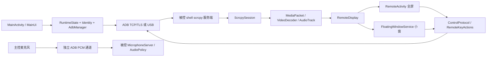

# 开发接手文档

整理日期：2026-10-21。源码基线为 0.6.0-dev（versionCode 8），此前 0.4.1 功能提交为 `2f877c1`。本文总结此前开发、实现选择和验证证据，供未读过聊天历史的 agent 接手。后续以用户最新要求和实际源码为准，修改后同步本文。

## 1. 项目目的与当前结论

把 scrcpy 的主控端迁移到 Android：Android 主控通过无线调试配对/TCP ADB 或 USB/OTG 连接另一台 Android，显示画面并控制触摸/按键，可同步声音与文本剪贴板、传文件和扫描用户指定端口。重点目标是 Android 16 主控，用户的被控实体设备主要是 Android 15。

当前主控为普通 APK，不要求 root 或无障碍服务。通过 ADB shell 上传、运行配套 scrcpy 服务端；一般远控不需要被控端安装主控 APK。测试 APK 为实验室探针，不能误认为生产安装依赖。

基础功能、分级 UI、可交互小窗、实体音量键、电源操作、原生自动旋转及透明度设置已实现。主控麦克风提供实验性按应用转发，通用摄像头输入替换未实现。媒体剪贴板、自动重连和精确音画时钟同步也未实现。

## 2. 文档分工与阅读顺序

| 文件 | 用途 |
| --- | --- |
| [AGENTS.md](../AGENTS.md) | Agent 每次任务的操作约定、重要约束和测试选择 |
| 本文 | 历史、架构、关键实现、源码索引、接手方法及已知问题 |
| [requirements-and-regression.md](requirements-and-regression.md) | 当前功能需求编号、UI 行为、验收与实体机清单、重构约束 |
| [TESTING.md](../TESTING.md) | 各版本实际执行结果及未验证范围；不能当作每次任务都自动重测 |
| [README.md](../README.md) | 用户使用、构建、仓库结构和快速测试说明 |
| [INPUT_SHARING.md](../INPUT_SHARING.md) | Android 14+ 麦克风/摄像头调查、权限边界、原型和实测证据 |
| [ui-assets.md](ui-assets.md) | 小窗 Material Components、矢量图标及许可来源 |
| [vendor/adb/UPSTREAM.md](../vendor/adb/UPSTREAM.md) | LibADB 固定来源及本地补丁 |
| [vendor/adb/USB_TRANSPORT.md](../vendor/adb/USB_TRANSPORT.md) | USB 通道设计及随 vendored 代码保留的验证说明 |

本文中的状态是截至整理日期的快照。`dist/` 与本地日志被 Git 忽略，其他检出可能只有源码和已提交文档，不一定包含 APK、缓存或截图。

## 3. 开发历程与被替换的旧设计

| 阶段 | 已完成内容 | 目前仍应保留的结论 |
| --- | --- | --- |
| 0.1.0 基础迁移 | ADB 身份、PIN 配对、TCP/USB、Shell、投屏/控制、多指、声音、文本剪贴板、扫描及文件传输 | 后续升级应保留同一身份；配对端口与连接端口不同 |
| 0.2.0 UI 与小窗 | 三个一级入口、二级工具/配对/凭据页、设备管理、可拖动悬浮球、小窗和音量实体键同步 | 不再把所有功能堆到一个页面；小窗只保留基本操作 |
| 一键启动补丁 | 已连接时右下角显示远控快捷按钮，任意页面可一键启动 | 当次只加按钮及验证按钮，不扩大改动范围 |
| 仓库重组 | Android 项目移到根目录，scrcpy 保留独立子 Git 仓库并接为子模块 | 不恢复旧 `android-client/` 模块结构；服务端构建接入不污染上游 |
| 0.3.0 | 调查输入共享；增加按应用 UID 的实验麦克风转发 | 摄像头没有通用普通 APK + ADB 方案；不要展示虚假的成功入口 |
| 0.4.0 | 电源/唤醒/长按/组合键、小窗底栏、原生方向跟随、远端通知面板、透明度设置 | 按电源→底栏→方向→外观逐项测试后做整体回归 |
| 0.4.1 | 两栏等高、统一圆角裁切、图标化、斜线拖动手柄、ADB 设备名与自适应省略 | 加减缩放按钮及小窗“电源/全屏”文字已被取代，不要按 0.4.0 截图恢复 |
| 0.5.0 | 多端点 ADB、多小窗、单全屏、最新连接快捷入口、后台保活及可选自动小窗 | 每个设备固定自己的 ADB/session/output；后台继续停止敏感输入，不自动重启麦克风 |
| 0.5.1 | 控制队列有效期/容量与 MOVE 合并、安全输入释放、解码输出追帧 | 队满不再结束会话；不能截断已开始的协议帧或随意丢 H.264 参考帧；尚未实测真机弱网 |
| 0.6.0-dev | 分辨率与音视频全局启动快照、主屏/虚拟显示回退、压缩音频和可选编解码组件 | 设置仅新会话生效；逻辑尺寸与编码上限独立；原始尺寸也遵循路线偏好；退出恢复主屏已有 override |

主仓库现有关键提交：`5b99ccd` 仓库重组、`d6ae69a` 麦克风、`c1c97b9` 电源/方向/设置、`2f877c1` 小窗微调。0.1/0.2 的功能早于主仓库重组，不能推断它们各有独立的根仓库版本提交。

## 4. 仓库与构建关系

```text
根 Android application（src/main）
  ├─ :adb-library → vendor/adb
  ├─ :server → scrcpy/server，构建文件改由 gradle/scrcpy-server.gradle 提供
  └─ :input-server → src/inputServer，构建文件 gradle/input-server.gradle

bundleScrcpyServer
  ├─ build/scrcpy-server/outputs/apk/debug/server-debug.apk
  │    → build/generated/serverAssets/scrcpy-server.jar
  └─ build/input-server/outputs/apk/debug/input-server-debug.apk
       → build/generated/serverAssets/scrcpy-input-server.jar
```

后缀为 jar 的这两个资产实际上是包含 dex 的 APK 容器，经 `app_process` 加载，不安装到被控端。根 `preBuild` 自动依赖资产构建。无需为了 Android 主控去构建桌面 C/SDL 客户端，也不应下载另一个版本的预编译服务端替代源码产物。

`scrcpy/` 来源 `https://github.com/Genymobile/scrcpy.git`，固定 5.0.1 / `a60891aea193d92e7e5c3942700eca63f9d19a5f`。`settings.gradle` 将 `:server` 的 projectDir 指向子模块，同时选择根目录的适配构建文件，输出写入根 `build/`。新克隆使用 `--recurse-submodules` 或执行 `git submodule update --init --recursive`。

当前固定构建配置：

| 项目 | 值 |
| --- | --- |
| 主控 applicationId / namespace | `org.scrcpy.android` |
| 主控 min / target / 默认 compile SDK | 30 / 36 / 36 |
| 可选麦克风接收模块 min SDK | 34 |
| Gradle Wrapper / AGP | 9.3.1 / 9.1.0 |
| Java 源码/目标级别 | Java 8；构建使用 JDK 21 或以上 |
| AndroidX Core / Activity | 1.15.0 / 1.9.3 |
| Material Components | 1.13.0，仅小窗使用独立主题 |
| BouncyCastle / JUnit | 1.84 / 4.13.2 |
| LibADB Android BC | 3.4.0，固定提交见其 UPSTREAM.md |

## 5. 架构与源码入口

生产 Java 源码统一在 `src/main/java/org/scrcpy/android/`；下表文件名省略该前缀。

| 文件 | 职责 |
| --- | --- |
| `MainActivity.java` | 连接/配对/USB 授权/扫描/文件选择器等操作协调；任务执行、取消和状态展示 |
| `MainUi.java` | 程序化分级页面、设备/凭据管理、连接后快捷按钮、外观设置 |
| `Identity.java` / `AdbManager.java` | 加密持久 RSA 身份及 LibADB 管理适配；USB/TCP 共用身份 |
| `RuntimeState.java` / `DeviceConnection.java` | 共享 RSA/配对管理器、端点连接注册表、当前工具目标与最新连接；各设备独立 ADB/session/worker/Shell；进程级音频焦点和超时执行器 |
| `BackgroundOutput.java` | 独立 EGL 线程持续消费不可见 Surface，后台不重建解码器或连接 |
| `AdbSync.java` / `PortScanner.java` | 分块文件传输和单目标 IPv4 端口扫描 |
| `ScrcpySession.java` | 上传/启动服务端、连接各流、媒体解码播放协调、控制队列、会话所有权与清理 |
| `ControlQueue.java` / `ControlInputState.java` | 有界、过期淘汰与 MOVE 合并；跟踪实际已发送输入、释放与孤立事件过滤 |
| `ControlProtocol.java` / `MediaPacket.java` | 固定 scrcpy 版本的控制序列化与动态视频会话/媒体包解析 |
| `VideoDecoder.java` / `AudioPlayback.java` | MediaCodec 多格式视频/音频解码、PCM 播放输入及视频输出 Surface 切换 |
| `StreamSettings.java` / `StreamPreferences.java` / `StreamSettingsView.java` | 校验后的不可变参数快照、全局持久化与设置页草稿/保存 |
| `SessionDisplay.java` / `DisplaySizeState.java` / `DisplayFallback.java` | 主屏尺寸租约、持久恢复记录、原 override 解析和有界显示路线回退 |
| `VideoFrameDrain.java` | 有界批次追赶解码输出，只显示该批最新可用帧 |
| `RemoteDisplay.java` | 公共 SurfaceView、视频等比布局、触摸映射、多指释放、输出所有权 |
| `RemoteActivity.java` | 全屏球菜单、前台剪贴板、实体音量键、方向、麦克风及权限生命周期 |
| `RemoteKeyActions.java` | 有界电源/唤醒/组合键按下与松开 |
| `RemoteRotationMonitor.java` / `RemoteOrientation.java` | 后台物理显示方向查询、代次取消、四方向转换及比例回退 |
| `FloatingWindowService.java` / `FloatingWindow.java` / `WindowGeometry.java` | 可交互 overlay、通知、两栏、图标、角落缩放、移动、边界/比例与恢复全屏 |
| `RemoteDeviceName.java` | 解析显示用设备名/机型回退，不写已保存设备别名 |
| `UiPreferences.java` | `remote-ui` 外观偏好及 20–100% 不透明度约束 |
| `MicrophoneForwarder.java` | 可选主控 AudioRecord / PCM 转发、被控包名和 UID 查询、超时与清理 |
| `DebugLog.java` / `LogProvider.java` | 滚动诊断日志及临时 URI 分享 |

独立接收端为 `src/inputServer/java/org/scrcpy/android/input/MicrophoneServer.java`。测试源码见 `src/test/`、`src/androidTest/` 与 `vendor/adb/src/test/`；主 APK 没有测试探针 Activity。



## 6. 运行时关键链路与约束

### 6.1 连接、界面和持久化

`MainActivity.task()` 设置 busy / `RuntimeState.operationRunning`、禁用操作按钮，在 worker 完成网络工作，再回 UI 更新。连接/配对期间 LibADB manager 可能持有锁；`MainUi.connected()` 始终读取 `DeviceConnection.connected` 缓存，防止导航在主线程等待连接锁。连接探测和失联清理在后台执行；不可改回主线程查询 manager。

持久数据不能随 UI 改动清除：

| 位置 | 内容 / 约束 |
| --- | --- |
| Android Keystore `scrcpy-adb-identity-v1` | 不可导出的 AES 包装密钥 |
| `getNoBackupFilesDir()/adb-identity.enc` | AES-GCM 加密的 RSA 私钥和证书，AtomicFile 写入；解密失败不应静默换新身份 |
| SharedPreferences `devices` | 主机、端口、音频选项、最近设备 JSON、别名/配对状态等 |
| SharedPreferences `remote-ui` | 球位置、clipboard、volumeKeys、autoRotate、窗口位置/宽度、通知提示标记、三种 opacity |
| SharedPreferences `stream-settings` | 全局分辨率、显示路线、编解码格式/组件和性能参数；现有会话不监听变化 |
| SharedPreferences `display-recovery` | 端点原有主屏尺寸 override/reset；先持久写入再覆盖，恢复确认后删除记录，不含身份材料 |
| 临时 Intent / 字段 | PIN 只供当次配对，不保存；设备记录删除不撤销远端授权 |

身份恢复依赖同一应用签名和 Keystore；覆盖安装使用 `adb install -r`。不要为修复连通性先 `pm clear` 或卸载。清除列表、重置身份和被控端撤销授权是不同操作。

### 6.2 服务端、媒体和控制

每次会话使用随机 scid，上传 `/data/local/tmp/scrcpy-android-<随机值>.jar`，经 shell `CLASSPATH=... app_process / com.genymobile.scrcpy.Server 5.0.1 ...` 启动，连接 `localabstract:scrcpy_<scid>`。同一 ADB 连接承载独立视频、可选音频、控制与辅助 Shell 流。

视频默认为 H.264，最大边 1600、60 fps、6 Mbps；设置可选 H.265/AV1/VP8/VP9、最大边（0 不限）、帧率/码率和具体组件。v5 在初始/旋转时使用新的 12 字节视频会话头，不能套用旧版本仅一次固定宽高的读法。媒体包单包分配上限 16 MiB；视频尺寸验证上限 16384。声音默认远端 PCM，也可选 AAC/Opus/FLAC，最终均以 48 kHz 双声道 PCM16 交给 AudioTrack。`Streamer` 对 Opus/FLAC 配置包做过精简，AudioPlayback 需重建 Android 所需的 CSD（Opus 预跳过/预滚动、FLAC marker 和 STREAMINFO 块），不能把压缩数据直接写给 AudioTrack。

0.6.0-dev 启动先读取 StreamSettings 快照并查询配套服务端 `list_encoders`，验证本地解码器与远端编码器。按用户偏好尝试主屏尺寸/独立虚拟显示，均失败后使用原始主屏；音视频设置失败另外回退 H.264/PCM。回退只发生在建立阶段，首帧/音频就绪后真实断线仍结束会话。每次尝试使用独立 scid 和启动 jar，保留上游 cleanup；退出释放所有尝试的流和临时文件。首帧就绪检查独立于后续媒体包，静态画面不必等待下一包才能启用控制。

主屏尺寸覆盖由 SessionDisplay 按端点共享租约保护；已有 override 不是物理原生尺寸，必须原样恢复，不能一律 `wm size reset`。新会话接管前恢复旧租约，旧会话延迟清理检查所有权；显式 ADB 断开在后台有界等待清理。异常断网/强停可能留下覆盖，记录保留到下次同端点会话恢复。新建虚拟显示时通过 16 号 START_APP 消息启动用户包名/默认桌面/系统设置，使用 `vd_destroy_content=false` 请求关闭后任务移回主屏；不保证所有 ROM/应用支持独立桌面。虚拟 display ID 来自固定配套服务端日志，方向查询必须使用该 ID。未接入 flex_display 或随窗口连续 resize。

控制采用独立写线程和 `ControlQueue`：最多 64 条、总负载 512 KiB、有效期 250 ms，超时/溢出丢最早操作；同一触点的待发送 MOVE 保留最新值但不跨 DOWN/UP。等待 `AdbStream.awaitWriteReady()` 后才取队列并再次检查有效期，防止旧事件已出队后滞留在 WRTE 许可等待中。队满不再结束会话。`ControlInputState` 跟踪成功写入的触点和键；丢弃任何输入后，先集中补发已发送输入的 UP（组合键逆序），过滤没有已发送 DOWN 的 MOVE、键重复和 UP。被取消的持续手势需要松手重按。控制与媒体字段采用大端；`AdbSync` 的 sync v1 长度/数值使用小端，路径独立 UTF-8 编码，64 KiB 分块并设 10 分钟传输期限，不经 Shell 拼路径。

视频仍完整解码 H.264 参考链，开启 `KEY_ALLOW_FRAME_DROP`，非阻塞取出已就绪的解码输出、丢弃较旧帧，只呈现最后一帧；单轮最多丢 32 帧，避免持续有输出时不显示。没有后续输出的最后一帧立即显示。关闭日志记录队列过期/溢出/合并及视频丢帧计数，不记录事件正文。此策略处理应用队列和解码显示积压，不能撤回已经写入 TCP/USB 的数据、截断已开始的大剪贴板分块消息，不能解决所有传输/编码积压，也不等于 UDP 丢包或端到端延迟上限。[MediaCodec 文档](https://developer.android.com/reference/android/media/MediaCodec)说明解码输出可不渲染释放；不连续压缩输入则需要合适的关键帧边界。

常用 scrcpy 5.0.1 控制类型：0 按键、2 触摸、5 通知栏、6 快捷设置、7 收起面板、8 获取剪贴板、9 设置剪贴板、11 远端旋转。完整协议以子模块 `ControlMessage` / reader 为准。按键消息保留 action/repeat/meta；不要丢弃实体键长按重复。

### 6.3 Surface 所有权与生命周期

`RemoteDisplay.surfaceCreated()` 在该设备独立 worker 中创建新 session 或 `attachOutput()`。session 的当前 listener 标识拥有者。全屏/小窗交接先让新 Surface 成为输出，再关闭旧组件；`dispose()/surfaceDestroyed()` 只有在 `ownsSession()` 为真时才结束会话。

因此正常往返不重新上传、不重启服务端、不重连媒体流，音频也继续。关闭小窗清理 session 但保留 ADB。`ScrcpySession.close()` 丢弃未发送操作并异步关流，给控制线程 500 ms 尝试释放已经发送的触点/按键；不能从 UI 同步等待坏网络。

0.5.0 全屏默认后台保活：onPause 释放输入/麦克风/剪贴板/方向监控，按设备 worker 将输出切至持续消费帧的 EGL Surface；恢复后 attachOutput 回到 Activity。可关闭保活恢复旧行为。可选 Home 自动转小窗，缺少 overlay 权限时保留不可见后台输出。所有连接由 connectedDevice + mediaPlayback 前台服务管理，活动远控持有 partial wake lock。权限引导期间使用 awaiting 状态，不能因过早 `onStop` 破坏系统权限流程。触点、实体键、电源组合键必须在暂停/方向变化/交接释放。全屏 manifest 的 configChanges 与原生方向实现共同避免 Activity 重建导致丢会话。

### 6.3.1 多设备所有权

`RuntimeState` 只持有共享身份/配对 manager 与端点注册表；`DeviceConnection` 绑定一个 ADB、session、worker、后台输出。远控、名称查询、方向和麦克风接收/清理必须引用创建时绑定的 DeviceConnection，不能随当前工具选择改目标。`current()` 用于工具，`latest()` 只在新连接成功时改变；旧端点重复选择不改变最新顺序。失败保留其他设备。

`FloatingWindowService` 维护端点到 `FloatingWindow` 的映射；恢复全屏只移除已转移的那个窗口。RemoteActivity 为 singleTask，onNewIntent 切换设备时释放旧全屏远控，保留其他窗口。关闭远控保留 ADB，显式断开只删除对应端点。后台输出须在视频线程退出后释放 EGL；不能提前释放仍被 MediaCodec 使用的 Surface。

前台类型及其网络权限前置条件参照 [Android foreground service types](https://developer.android.com/develop/background-work/services/fgs/service-types)。这是连接外部 ADB 设备和接收播放远端媒体，主控不使用 MediaProjection 捕获本机屏幕。

### 6.4 当前 UI 最终约定

- 一级页面：连接 / 设备与凭据 / 工具；配对、扫描、Shell、文件、凭据、设置为二级入口。连接后右下角按钮随处启动最新成功连接设备的远控；设备页分别管理多个连接与小窗。
- 全屏使用可拖动球展开菜单；退出走明确菜单，返回手势发送远端 BACK。音量实体键默认同步，可关闭。
- 电源短按/唤醒约 80 ms，长按约 800 ms，组合约 400 ms；新动作释放旧动作，组合 DOWN 放在同一写入中、UP 逆序释放。实际系统动作依赖 ROM。
- 自动方向默认开：后台约每 1.2 秒查物理 display 0；读取 2 秒超时/256 KiB 上限，ADB 打开另受库超时约束。不可用时按视频比例回退；比例无法区分正反方向。原生 `setRequestedOrientation()`，不旋转视频代替界面。
- 小窗是 40 + 视频 + 40 dp 两栏，四周 2 dp，总非视频 84 dp，12 dp 圆角对子 View 一起裁切。最小宽度一般 160 dp，极端比例可留黑边以保住操作区，禁止拉伸。
- 两个角落斜线仅拖动，轻触不缩放；中间图标恢复全屏，顶部电源图标点按/长按。顶部设备名仍是移动区域。
- 名称优先 `settings get global device_name`，回退 `ro.product.model` / Android；独立后台查询，目标或服务失效丢弃回调。标题 weight 占剩余宽度并单行末尾省略，缩放触发原生布局，不按固定字符数截断。
- 小窗不转发本机音量键，不同步剪贴板、不采集主控麦克风，不强制主控方向。
- 三种不透明度均默认 100%、范围 20–100%；小窗用 WindowManager 整体 alpha，视频和栏一起变化。透明度不改变点击命中区域。

### 6.5 麦克风与摄像头边界

麦克风是反方向、独立可选链路：主控 AudioRecord → 48 kHz 单声道 PCM16 → ADB localabstract → 被控 shell `MicrophoneServer` → AudioPolicy 按目标 UID 注入 → 目标应用自己的 MIC / VOICE_COMMUNICATION AudioRecord。

接收端通过反射使用系统音频路由，需 Android 14+ 且 shell 有 MODIFY_AUDIO_ROUTING。目标 UID 必须为普通应用，主控需 RECORD_AUDIO，目标应用仍要取得自己的录音授权。共享 UID / 多用户、SIM 通话、厂商专有通道不保证兼容。帧长度与 PCM 合成一次 ADB WRTE，避免每帧多一次确认造成欠载；停滞约 5 秒关闭。退出/小窗/后台停止，不能自动恢复采集。

通用摄像头输入替换尚未实现。scrcpy 捕获被控摄像头与“把主控摄像头供远端应用使用”方向不同；系统虚拟设备/相机注入或 USB UVC 有额外权限和硬件边界。后续研究应基于 INPUT_SHARING.md，不承诺任意 Android 14+ 普通 APK 都支持。

## 7. LibADB 本地改动与已知未修复项

已保留的适配：TCP/配对/TLS 有界超时；握手失败关配对 socket；避免输出配对 peer 信息；InputStream 语义修复；批量读取/有界背压；区分远端正常 EOF 与断连；USB AdbChannel/UsbBulkIo 适配及测试；guarded stream-open 等待防 lost wakeup；并发流 ID 使用 AtomicInteger；已 OKAY 后立即 CLSE 视为正常空流，未 OKAY 的 CLSE 仍拒绝。

**已知未修复：非 ASCII OPEN 服务字符串。** [AdbProtocol.java](../vendor/adb/src/main/java/io/github/muntashirakon/adb/AdbProtocol.java) 的 `generateOpen()` 用 `destination.length() + 1` 分配，却写入 UTF-8 字节。包含中文等多字节字符的 Shell service 字符串可能抛 `BufferOverflowException`。0.4.1 测试在设置中文设备名时实际触发，未修改产品传输；fixture 用 ASCII Base64 命令在目标解码后再由真实名称查询读回。中文标题能显示不代表任意中文 Shell 命令已可用。若后续修复，应按 UTF-8 字节长度构造报文，并增加对应 OPEN/连接回归；不要只把测试绕过写成产品修复。

`vendor/adb/USB_TRANSPORT.md` 中 Pixel/libusb 实机与吞吐描述是随 vendor 保留的说明，不等于本项目的 Android UsbDeviceConnection 主控已做真机 OTG 验收。当前 Android 侧 OTG 线材、授权、供电、拔线/OEM 矩阵仍待实体测试。

**0.5.0 旋转验证待查风险**：多设备/后台专项、原有 `windowUi`（含一次旋转）及麦克风通道回归通过；独立四方向专项未完整通过，主控原生方向跟随后视频比例有时不更新。0.4.1 APK 对照也在小窗视频旋转阶段失败，但失败阶段不同，不能据此认定根因相同或排除 0.5.0 回归。暂未改上游或媒体协议；后续需复查视频重配与目标/主控渲染状态，不能沿用历史四向 PASS 作为本版已全过的证据。实际范围见 TESTING.md。

其他未完成/未承诺：媒体剪贴板、自动重连、精确音画同步/漂移补偿、后台或小窗麦克风、通用摄像头替换、普通应用彻底拦截本机系统栏、彻底关机设备远程开机。长时间自然熄屏后的电源控制已提供，不代表新增了远端永不熄屏策略。

## 8. 通用构建与测试准备

准备 JDK 21 或以上、Android SDK API 36 和 platform-tools。通过 `JAVA_HOME` 配置 JDK，通过 `ANDROID_HOME` 或未提交的 `local.properties` 中 `sdk.dir` 配置 SDK；使用仓库的 Gradle Wrapper。

```shell
./gradlew :assembleDebug
./gradlew :assembleDebugAndroidTest
```

Windows 使用 `gradlew.bat` 执行相同任务。默认 compileSdk / targetSdk 均为 36；可选属性 `-PandroidCompileSdk=<API>` 只覆盖 compileSdk，不改变 targetSdk，覆盖时应自行核对工具链兼容性。

产物：`build/outputs/apk/debug/ScrcpyForAndroid-debug.apk` 与 `build/outputs/apk/androidTest/debug/ScrcpyForAndroid-debug-androidTest.apk`。

设备测试使用明确指定的主控和被控设备。先通过 `adb devices -l` 核对角色与 Android 版本，再读取被控端当次无线调试地址、连接端口与配对信息。以下尖括号内容均为待替换参数，不能原样执行：

```text
adb -s <主控序列号> shell getprop ro.build.version.sdk
adb -s <被控序列号> shell getprop ro.build.version.sdk
```

所有设备操作明确使用 `-s`，不能把所有在线设备当测试目标。不为只写文档而启动 ADB、安装 APK、断开连接或修改设备设置。

## 9. 验证选择与真实证据

### 9.1 怎么选测试

| 改动类型 | 建议验证 |
| --- | --- |
| 文档/AGENTS | 相对链接和源码路径、内容一致性、diff；无需 Gradle/ADB |
| 小窗局部样式/图标/标题 | 编译、必要 Lint、`-e uiStage window` 与截图 |
| 电源或键释放 | 协议测试及 `-e uiStage power`；核对实际可见菜单/释放，不只查窗口名 |
| 方向/生命周期 | RemoteOrientationTest、`-e uiStage rotation`、按影响补窗口往返/原有远控回归 |
| 外观设置 | `-e uiStage settings`，检查持久化、实时 alpha 和身份不变 |
| 配对/身份/主界面连接 | `mainUiOnly`、新鲜 PIN 正/错误路径、重启复用身份；必要 `connectOnly` |
| LibADB/控制/媒体基础 | 相关 JVM 测试及受影响集成回归；USB 硬件 SKIP 不能算 PASS |
| 麦克风 | MicrophoneTargetTest、`microphoneOnly`，涉及实际采集/授权时另测 UI 权限与停止 |

不要为局部可逆 UI 修改机械添加复述实现的单元测试或重跑所有功能；也不要在改变共享协议/所有权后只看编译。用户指定测试范围时遵守其范围，发现直接关联风险再说明并验证。

```shell
# 按需要选择任务，不要求每次全跑。
./gradlew :testDebugUnitTest
./gradlew :adb-library:testDebugUnitTest
./gradlew :lintDebug
```

示例：仅小窗专项。先在明确的专用设备安装所需 APK、授予测试权限，再替换占位参数：

```text
adb -s <主控序列号> shell am instrument -w -e host <被控IP> -e port <被控ADB连接端口> -e uiStage window org.scrcpy.android.test/org.scrcpy.android.SmokeInstrumentation
```

其余参数：`uiStage power/rotation/settings`（每次一个）、`-e windowUi true`（原有完整远控+窗口）、`-e mainUiOnly true`、`-e connectOnly true`、`-e microphoneOnly true`；新 PIN 可配合 `-e pairPort` / `-e pin`，错误 PIN 路径使用 `-e expectPairFailure true`（不要同时设置 `mainUiOnly true`）。完整准备/安装示例见根 README，勿把临时 PIN 写进共享文档或日志。

探针可能清空目标 Logcat、写文件/生成截图、暂改旋转/长按电源/设备名、录制测试音频。结束恢复系统和 UI 偏好并停止探针/小窗。真实设备通过用户当次授权的步骤验收，不能直接照搬专用模拟器预授权命令。成功检查 `result=PASS` 与 `INSTRUMENTATION_CODE: -1`，主机 adb 正常退出不代表测试通过。

### 9.2 历史验证范围

- 0.1/0.2：基础 ADB、文件/扫描、音视频、多点、文本剪贴板、导航/凭据、音量实体键、小窗往返及关闭有历史证据。
- 仓库重组：66 个应用/vendored 文件迁移前后哈希一致；只重测已有身份连接、快捷启动、视频和单点控制，不能说当次全量测试。
- 0.3：5 项麦克风目标单元测试；确定性 1 kHz PCM 经生产通道让独立 UID 应用以 MIC 与 VOICE_COMMUNICATION 实际录到、停止恢复路由、停滞自动关闭和并发视频；另有当时 UI 的权限拒绝/允许与后台停止证据。
- 0.4.0：应用 21 项及 ADB 25 项 JVM 测试通过，2 项物理 USB 测试跳过；新增四专项、原有 windowUi、主界面连接、新 PIN 实际配对和新进程 TLS 身份复用、确定性麦克风回归通过；Lint 0 错误/26 警告。
- 0.4.1：只构建、Lint 和更新后的小窗专项；等高栏/圆角/图标/手柄/长中文标题/触控隔离/电源点击/同会话恢复及截图通过；Lint 0 错误/28 警告。未重跑其他功能，未宣称 0.4.1 所有 JVM 测试重新运行。

Android 16 控制 Android 15 实体机、Android OTG 物理链路、OEM 电源组合行为、折叠/平板策略及真实双向通话质量尚未在这些记录中验收。模拟器通过不等于这些已完成。完整原始描述保留在 TESTING.md。

## 10. 踩坑、排查和发布

### 10.1 不要重复引入的问题

- **异步窗口测量**：WindowManager 更新参数后，TextView/Surface 的实际布局要到后续帧才完成；测省略字符数/比例前等待布局，不读取上一次宽度。先取得截图再读取最终布局可用于专项中的稳定比较。
- **原生旋转与菜单动画**：Activity 启动同步返回不代表方向动画/弹窗已稳定。等待焦点、布局和必要过渡，再对真实菜单坐标触控；不要用立即 `performClick` 取代所有可见性验收。
- **电源测试**：AWAKE 早于屏幕亮起完成；两个 POWER 手势过近可触发系统双击；截图预览与电源菜单有过渡。先等松键/动画，避免另一 Shell 流的清理命令越过控制队列；以实际 `isVisible` 确认目标菜单。
- **最小边界**：已在最小尺寸时缩小不应变化。0.4.0 的点击加减测试已经过期；0.4.1 测试使用真实拖动且检查轻触不缩放。
- **流式读取**：OKAY 后马上 CLSE 可能是零输出命令成功结束；不能又改回“closed 就一定拒绝”。对应并发流和 EOF 回归已有。
- **截图文件**：重复 `adb pull <目录> <已存在目录>` 可能多嵌套一层，别误读旧截图。按完整文件名取回，保存原图再检查；不要用编辑过的示意图充当实际 UI。
- **Shell 参数**：目标 Shell 值使用合适转义，避免字符串拼接导致命令注入；文件传输使用 ADB sync，不把路径拼入 Shell。

### 10.2 日志与反馈

主界面更多菜单/工具页可导出日志；Logcat 标签 `ScrcpyAndroid`。内部 `files/debug.log` 超过约 2 MiB 轮转为 `debug.previous.log`；LogProvider 通过临时 URI 分享。调试 APK 可读取：

```text
adb -s <主控序列号> logcat -v threadtime -s ScrcpyAndroid AdbConnection AndroidRuntime
adb -s <主控序列号> shell run-as org.scrcpy.android cat files/debug.log
```

需要收集主控/被控型号和 Android 版本、连接方式、复现步骤、相关开关/透明度、目标系统电源行为、截图和阶段日志。日志不应新增 PIN、私钥、剪贴板正文或音频数据。尤其不要清空用户的真机日志再开始排查。

测试摘要和验证边界写入 `TESTING.md`，原始日志和截图按任务保存在被忽略的 `test-results-local/` 中，不覆盖已有证据，也不假定新检出中包含这些文件。

### 10.3 交付产物与维护

debug APK 按 `dist/ScrcpyForAndroid-<版本>-debug.apk` 命名，校验清单为 `dist/SHA256SUMS.txt`。产物目录被 Git 忽略，每次交付按实际文件生成校验值并保留旧产物；正式分发需自行配置发布签名。

代码交付时按需求更新版本/产物，并同步需求、实际测试和本接手文档；仅文档交付不更新 APK/版本。主仓库和子模块分别检查状态，保留用户工作，写本地提交不自动推送/发布。未来若改动协议、持久格式、SDK 目标或全屏/小窗所有权，必须重新评估兼容和回归范围，不能复用旧的“通过”结论。
